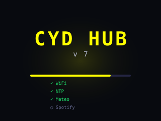
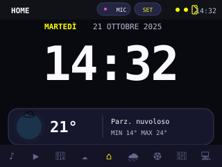
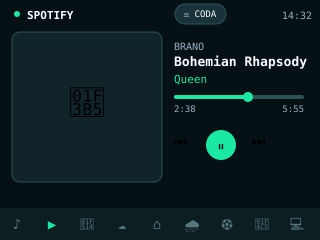
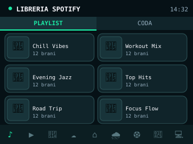
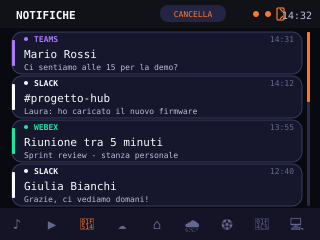
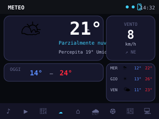
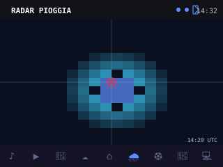
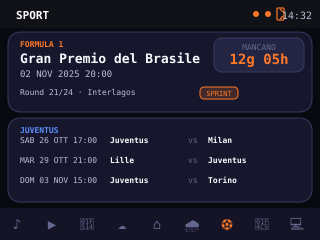
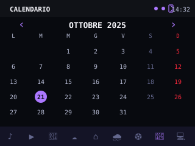
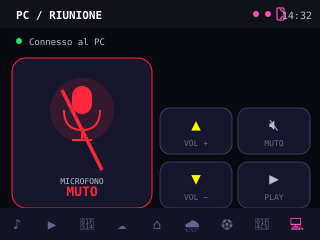

# CYD Hub

**Firmware v7.0** · Dashboard touchscreen per **ESP32-2432S028R** (Cheap Yellow Display) con tema scuro **Nebula**.

Spotify, meteo, radar pioggia, sport, calendario, notifiche del PC e controllo del PC via Bluetooth, tutto su un display 320×240. La pagina iniziale è l'orologio.

---

## Anteprima

> Mockup ricostruiti dal layout di `src/main.cpp` con dati dimostrativi, non screenshot.

| Avvio | Home / Orologio | Spotify Player |
|:---:|:---:|:---:|
|  |  |  |

| Playlist / Coda | Notifiche PC | Meteo |
|:---:|:---:|:---:|
|  |  |  |

| Radar pioggia | Sport — F1 + Juventus | Calendario |
|:---:|:---:|:---:|
|  |  |  |

| PC / Riunione |
|:---:|
|  |

---

## Pagine

| # | Pagina | Cosa fa |
|---|---|---|
| 0 | Playlist / Coda | playlist dell'account (griglia 2×3) e coda di riproduzione scrollabile |
| 1 | Spotify Player | copertina, brano, avanzamento, prev / play-pausa / next, pulsante CODA |
| 2 | Notifiche PC | storico delle notifiche di Teams, Webex e Slack |
| 3 | Meteo | condizioni attuali e previsione dei prossimi giorni |
| 4 | **Home** | orologio, data, meteo compatto, pulsanti MIC e SET |
| 5 | Radar pioggia | mappa radar RainViewer dell'area configurata |
| 6 | Sport | prossimo GP di Formula 1 e prossime partite della Juventus |
| 7 | Calendario | mese corrente e navigazione tra i mesi |
| 8 | PC / Riunione | microfono, volume, muto e play/pausa del PC via Bluetooth |

### Navigazione

- **swipe orizzontale** → pagina precedente / successiva;
- **barra in basso** → apre direttamente qualsiasi pagina;
- **swipe verticale** → scorre la coda Spotify e le notifiche;
- nella pagina PC i pulsanti del volume si ripetono tenendo premuto.

### Home

- orologio a grandi cifre, giorno e data, meteo con min/max;
- **MIC**: silenzia o riattiva il microfono del PC con un tocco (rosso = muto);
- **SET**: menu impostazioni (vedi [Menu SET](#menu-set)).

### Spotify — Playlist / Coda e Player

- **PLAYLIST**: 6 playlist per pagina, frecce per sfogliare, tap per avviarne una;
- **CODA**: elenco verticale con swipe e scrollbar, tap su un brano per riprodurre da lì;
- **Player**: copertina, titolo, artista, barra di avanzamento e controlli; il colore d'accento segue la copertina.

> Serve un dispositivo Spotify attivo; i comandi di riproduzione richiedono Spotify Premium.

### Notifiche PC

Notifiche di **Teams**, **Webex** e **Slack** lette dal centro notifiche di Windows e inviate al CYD via Bluetooth da [`tools/cyd_sync.py`](#script-per-il-pc--toolscyd_syncpy).

- ogni notifica nuova appare in un **popup** sotto la barra superiore, **su qualsiasi pagina**, per **10 secondi**; tocco sul popup → apre la pagina Notifiche, tocco altrove → lo chiude;
- il **LED RGB** lampeggia per 10 secondi col colore dell'app: **Teams viola**, **Webex verde acqua**, **Slack bianco** (gli stessi colori usati a schermo);
- la pagina conserva le **ultime 30**, le più recenti in alto: swipe verticale per scorrere, **CANCELLA** per svuotarla;
- quando lo script si collega invia anche le notifiche già presenti su Windows, che vanno nello storico senza popup;
- popup e LED si spengono da **SET → NOTIFICHE PC**; le notifiche continuano comunque ad arrivare nello storico.

Lo storico è in RAM: si azzera al riavvio del CYD e viene ricaricato quando lo script si ricollega.

### Meteo

Temperatura attuale e percepita, umidità, vento, min/max e previsione dei giorni successivi. Dati **Open-Meteo**, senza API key; la località si imposta in `src/config.h`.

### Radar pioggia

Ultima mappa radar di **RainViewer** sull'area configurata, aggiornata ogni 10 minuti o a mano.

### Sport

- **Formula 1** (API Jolpica / Ergast): prossimo GP con round, data e ora locale, countdown ed eventuale Sprint;
- **Juventus** (feed iCalendar `https://ics.fixtur.es/v2/juventus.ics`): prossime partite con data, ora e avversario.

Il pulsante di refresh aggiorna entrambe le sezioni.

### Calendario

Mese corrente con il giorno di oggi evidenziato; frecce per mese precedente e successivo.

### PC / Riunione

Il CYD si abbina a Windows come **tastiera Bluetooth LE** chiamata `CYD Hub`.

| Pulsante | Azione sul PC |
|---|---|
| MICROFONO | muto del microfono di sistema (con `cyd_sync.py`), altrimenti `Win+Alt+K` |
| VOLUME + / − | volume di sistema; tenendo premuto si ripete |
| MUTO | muto dell'audio di sistema |
| PLAY | play / pausa |

- **con `cyd_sync.py` attivo** lo stato ATTIVO / MUTO è quello reale del microfono predefinito di Windows, anche se lo cambi dal PC, e il tocco vale per tutte le app;
- **senza lo script** il tocco invia `Win+Alt+K` (muto nelle chiamate di Windows 11: Teams, Zoom, …) e lo stato mostrato è solo *presunto*;
- il volume è quello globale del PC, non quello di Spotify.

**Abbinamento:** *Impostazioni → Bluetooth e dispositivi → Aggiungi dispositivo → Bluetooth* → `CYD Hub`. Non serve PIN e l'abbinamento resta memorizzato.

---

## Script per il PC — `tools/cyd_sync.py`

Un solo script Python che parla con il CYD sullo **stesso collegamento Bluetooth della tastiera**: trova `CYD Hub` per nome tra i dispositivi abbinati, quindi **non servono IP né WiFi**.

- ogni 200 ms legge il muto del microfono predefinito e lo manda al CYD; quando tocchi MIC sul CYD, silenzia o riattiva il microfono di Windows;
- ogni secondo legge il centro notifiche di Windows e inoltra quelle di Teams, Webex e Slack.

### Installazione

```bash
pip install pycaw winrt-runtime winrt-Windows.Devices.Bluetooth winrt-Windows.Devices.Bluetooth.GenericAttributeProfile winrt-Windows.Devices.Enumeration winrt-Windows.Storage.Streams winrt-Windows.UI.Notifications winrt-Windows.UI.Notifications.Management winrt-Windows.Foundation winrt-Windows.Foundation.Collections winrt-Windows.ApplicationModel pystray pillow

python tools/cyd_sync.py
```

Lo stato del collegamento è nell'icona nel tray (passa il mouse per il dettaglio): **verde** collegato, **rossa** CYD non raggiungibile, **grigia** in connessione. Tasto destro → *Esci* chiude lo script.

- per le notifiche Windows deve concedere l'accesso: *Impostazioni → Privacy e sicurezza → Notifiche*; senza accesso lo script sincronizza solo il microfono;
- il primo collegamento può richiedere **circa 30 secondi** (ricerca Bluetooth di Windows); se il CYD è spento lo script riprova ogni 5 secondi;
- per seguire altre app basta aggiungerle alla lista `APPS` nello script.

### Avvio automatico con Windows

Apri la cartella Esecuzione automatica (`Win+R` → `shell:startup`) e crea un collegamento con destinazione:

```text
pythonw D:\progettini\esp32_hub\tools\cyd_sync.py
```

`pythonw` avvia lo script senza finestra. Per disattivarlo basta eliminare il collegamento.

### Risoluzione problemi

| Messaggio / sintomo | Cosa fare |
|---|---|
| `CYD Hub non abbinato al PC` | abbina il CYD da *Impostazioni → Bluetooth* |
| `servizio non trovato` | controlla in **SET** che il firmware sia v7.0 o successivo e che **BLUETOOTH PC** sia acceso; se è tutto a posto, **rimuovi `CYD Hub` dai dispositivi Bluetooth di Windows e abbinalo di nuovo** (Windows ricorda i servizi del firmware precedente) |
| il microfono sul CYD non segue il PC | lo script non è in esecuzione o non è collegato; dopo 3 secondi senza dati il CYD torna a `Win+Alt+K` |

---

## Menu SET

Si apre dal pulsante **SET** nella Home; in alto mostra la **versione del firmware**.

| Voce | Funzione |
|---|---|
| CALIBRA TOUCH | calibrazione guidata del touchscreen |
| RESET TOUCH | torna alla calibrazione predefinita |
| LED RGB | accende/spegne il LED (luce Spotify e lampeggio notifiche) |
| BLUETOOTH PC | attiva/disattiva tastiera e script PC (riavvia il CYD) |
| NOTIFICHE PC | attiva/disattiva popup e LED delle notifiche |

Le impostazioni restano salvate anche dopo il riavvio.

---

## LED RGB

- durante l'avvio cambia colore a ogni fase;
- con Spotify in riproduzione "respira" lentamente col colore della copertina, anche fuori dalle pagine Spotify;
- all'arrivo di una notifica lampeggia per 10 secondi col colore dell'app, poi torna allo stato precedente.

---

## Hardware

```text
ESP32-2432S028R · Cheap Yellow Display (CYD)
Display 320 × 240 · touch resistivo XPT2046 · LED RGB
```

Pin del touch: `CS=33  IRQ=36  CLK=25  MISO=39  MOSI=32`

| Ambiente PlatformIO | Target |
|---|---|
| `cyd` | CYD standard, driver ILI9341 |
| `cyd2usb` | variante con driver ST7789 |
| `cyd-wokwi` | simulazione Wokwi |

---

## Configurazione

### 1. Credenziali — `src/secret.h`

Copia `src/secret_example.h` in `src/secret.h` e inserisci i dati reali:

```cpp
#pragma once

#define WIFI_SSID_PRIMARY "..."
#define WIFI_PASS_PRIMARY "..."

#define WIFI_SSID_BACKUP "..."
#define WIFI_PASS_BACKUP "..."

#define SPOTIFY_CLIENT_ID_VALUE "..."
#define SPOTIFY_CLIENT_SECRET_VALUE "..."
```

All'avvio il CYD prova la rete **PRIMARY** per 15 secondi, poi la **BACKUP**. Senza WiFi parte comunque: orologio, calendario e controllo del PC via Bluetooth funzionano lo stesso.

`secret.h` è in `.gitignore`: non va mai messo su Git.

### 2. Impostazioni — `src/config.h`

```cpp
#define WEATHER_CITY "Imola"
#define WEATHER_LAT  "44.3592"
#define WEATHER_LON  "11.7132"
#define TZ_INFO      "CET-1CEST,M3.5.0,M10.5.0/3"   // ora legale automatica
#define ROTATION     3

#define SPOTIFY_POLL_MS    4000UL
#define WEATHER_REFRESH_MS (15UL * 60UL * 1000UL)
#define RADAR_REFRESH_MS   (10UL * 60UL * 1000UL)
#define F1_REFRESH_MS      (6UL * 60UL * 60UL * 1000UL)
```

### 3. Spotify

1. Crea un'app nella dashboard sviluppatori di Spotify e aggiungi il Redirect URI `http://127.0.0.1:8888/callback`.
2. Al primo avvio il CYD mostra un indirizzo da aprire dal telefono (stessa rete WiFi) e guida il collegamento dell'account.
3. Il refresh token resta salvato nel CYD. Per scollegare l'account tieni premuto lo schermo durante l'avvio.

Scope usati: `user-read-playback-state`, `user-modify-playback-state`, `user-read-currently-playing`, `playlist-read-private`, `playlist-read-collaborative`.

---

## Build e upload

```bash
pio run -e cyd -t upload        # CYD standard
pio run -e cyd2usb -t upload    # variante ST7789
pio run -e cyd-wokwi            # build per la simulazione
```

In Wokwi non ci sono WiFi né Bluetooth: i dati sono dimostrativi e i comandi del PC vengono solo stampati sul monitor seriale.

Librerie: `TFT_eSPI`, `XPT2046_Touchscreen`, `ArduinoJson`, `JPEGDEC`, `PNGdec`, `NimBLE-Arduino`.

---

## Servizi utilizzati

| Funzione | Servizio | Credenziali |
|---|---|---|
| Spotify | Spotify Web API | OAuth (una volta) |
| Meteo | Open-Meteo | nessuna |
| Radar | RainViewer | nessuna |
| Formula 1 | Jolpica / Ergast | nessuna |
| Juventus | Fixtur.es (iCalendar) | nessuna |
| Ora | NTP | nessuna |
| PC (microfono, notifiche, tasti) | Bluetooth LE | abbinamento |

---

## Struttura del progetto

```text
esp32_hub/
├── src/
│   ├── main.cpp            firmware (una sezione per pagina/servizio)
│   ├── config.h            località, fuso, intervalli
│   ├── secret.h            credenziali — NON versionare
│   └── secret_example.h
├── tools/
│   └── cyd_sync.py         script PC: microfono + notifiche via Bluetooth
├── docs/images/            mockup delle pagine
├── platformio.ini
├── diagram.json            schema Wokwi
└── wokwi.toml
```

---

## Versioni

La versione è definita da `HUB_VERSION` in `src/main.cpp`, compare nel menu SET e all'avvio e aumenta a ogni modifica del firmware.

| Versione | Novità |
|---|---|
| **7.0** | pagina Notifiche PC con popup e LED per app; script unico `cyd_sync.py` via Bluetooth (microfono reale + notifiche); voce NOTIFICHE PC e versione firmware nel menu SET |

---

## Sicurezza

Non pubblicare mai password WiFi, Client Secret o token Spotify. Se una credenziale è finita su Git, rimuoverla dal file non basta: va considerata compromessa e rigenerata.
